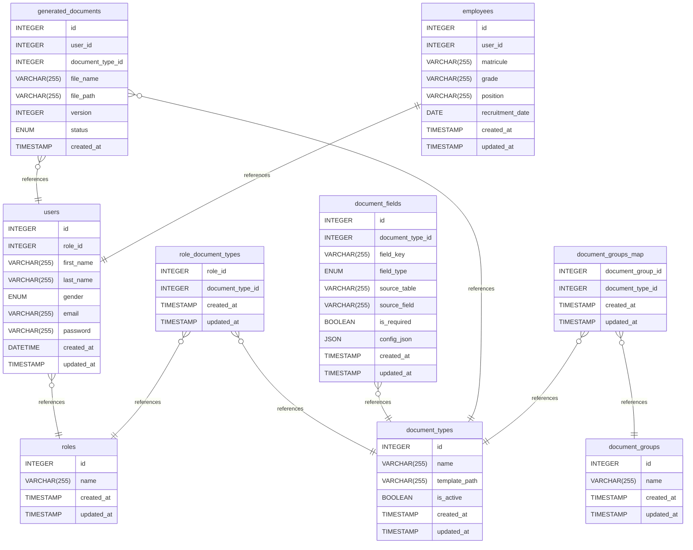

# CMC-DMS Database Documentation
---
## Table of Contents
1. [Introduction](#1-introduction)
2. [Database Type](#2-database-type)
3. [Core Design Overview](#3-core-design-overview)
4. [Table Structure](#4-table-structure)
   - 4.1 [document_types](#41-document_types)
   - 4.2 [document_groups](#42-document_groups)
   - 4.3 [document_fields](#43-document_fields)
   - 4.4 [document_groups_map](#44-document_groups_map)
   - 4.5 [generated_documents](#45-generated_documents)
   - 4.6 [users](#46-users)
   - 4.7 [role_document_types](#47-role_document_types)
   - 4.8 [roles](#48-roles)
   - 4.9 [employees](#49-employees)
5. [Relationships](#5-relationships)
6. [Database Diagram](#6-database-diagram)
---
## 1. Introduction

This database is designed for a Document Management System (DMS).
It handles document templates, dynamic fields, role-based access control, and generated document tracking with versioning.
The system allows controlled access to documents based on user roles and supports structured document generation from reusable templates.

---
## 2. Database Type

> [!NOTE]
> - **DBMS:** MySQL
> - **Model:** Relational database
> - **Architecture:** RBAC (Role-Based Access Control) with document template system

---
## 3. Core Design Overview

The system is built around the following components:

> [!TIP]
> - **Document Types:** Define templates and metadata
> - **Document Fields:** Define dynamic fields inside templates
> - **Document Groups:** Organize document types
> - **Roles:** Control access to document types
> - **Generated Documents:** Store output history with versioning per user
> - **Employees:** Extended profile for staff users

---
## 4. Table Structure

---
### 4.1 document_types
Stores document templates used for generation.

| Column | Type | Settings | Description |
|--------|------|----------|-------------|
| id | INTEGER | PK, not null, autoincrement | Primary key |
| name | VARCHAR(255) | not null | Unique template name |
| template_path | VARCHAR(255) | not null | Path to template file |
| is_active | BOOLEAN | not null, default: true | Whether template is active |
| created_at | TIMESTAMP | not null | Creation time (auto) |
| updated_at | TIMESTAMP | not null | Last update time |

> [!NOTE]
> **Constraints:** UNIQUE(template_name)

---
### 4.2 document_groups
Defines groups used to categorize document types.

| Column | Type | Settings | Description |
|--------|------|----------|-------------|
| id | INTEGER | PK, not null, autoincrement | Primary key |
| name | VARCHAR(255) | not null, unique | Unique group name |
| created_at | TIMESTAMP | not null | Creation time |
| updated_at | TIMESTAMP | not null | Last update time |

---
### 4.3 document_fields
Defines dynamic fields used in document templates.

| Column | Type | Settings | Description |
|--------|------|----------|-------------|
| id | INTEGER | PK, not null, autoincrement | Primary key |
| document_type_id | INTEGER | not null | Related document type |
| field_key | VARCHAR(255) | not null | Template placeholder key |
| field_type | ENUM | not null | Type of input field |
| source_table | VARCHAR(255) | null | Source table if AUTO |
| source_field | VARCHAR(255) | null | Source field if AUTO |
| is_required | BOOLEAN | not null, default: true | Required field flag |
| config_json | JSON | null | Extra configuration (used when not AUTO) |
| created_at | TIMESTAMP | not null | Creation time |
| updated_at | TIMESTAMP | not null | Last update time |

> [!TIP]
> **Field Types:** `AUTO` · `INPUT` · `SELECT` · `DATE` · `NUMBER` · `SYSTEM`
>
> - **AUTO:** Value is automatically retrieved from `source_table` and `source_field`.
>   - Example:
>     - `field_key`: `matricule`
>     - `source_table`: `employees`
>     - `source_field`: `matricule`
>
> - **INPUT:** User enters a free-text value.
>   - Example:
>     - `field_key`: `recipient_name`
>
> - **SELECT:** User selects one option from a predefined list.
>   - Example:
>     - `field_key`: `document_language`
>     - `config_json`:
>       ```json
>       {
>         "options": ["French", "Arabic", "English"]
>       }
>       ```
>
> - **DATE:** User selects a date.
>   - Example:
>     - `field_key`: `leave_start_date`
>     - `config_json`:
>       ```json
>       {
>         "format": "d/m/Y"
>       }
>       ```
>
> - **NUMBER:** User enters a numeric value.
>   - Example:
>     - `field_key`: `salary`
>     - `config_json`:
>       ```json
>       {
>         "min": 0,
>         "max": 100000
>       }
>       ```
>
> - **SYSTEM:** Value is generated by the system.
>   - Examples:
>     - `field_key`: `current_date`
>     - `field_key`: `reference_number`
>     - `field_key`: `title`
>     - `field_key`: `fullname`
>     - `config_json`:
>       ```json
>       {
>         "generator": "fullname"
>       }
>       ```
>
> `config_json` is optional and may contain additional configuration for **any** field type, such as validation rules, formatting, default values, select options, or generation settings.

> [!NOTE]
> **Constraints:**
> - UNIQUE(document_type_id, field_key)
> - INDEX(document_type_id)

---
### 4.4 document_groups_map
Many-to-many relation between document groups and document types.

| Column | Type | Settings | Description |
|--------|------|----------|-------------|
| document_group_id | INTEGER | PK, not null | Group reference |
| document_type_id | INTEGER | PK, not null | Document type reference |
| created_at | TIMESTAMP | not null | Creation time |
| updated_at | TIMESTAMP | not null | Last update time |

> [!NOTE]
> **Primary Key:** (document_group_id, document_type_id)
> **Index:** (document_type_id, document_group_id)

---
### 4.5 generated_documents
Stores history of generated documents per user.

| Column | Type | Settings | Description |
|--------|------|----------|-------------|
| id | INTEGER | PK, not null, autoincrement | Primary key |
| user_id | INTEGER | not null | Owner user |
| document_type_id | INTEGER | not null | Related document type |
| file_name | VARCHAR(255) | not null | Generated file name |
| file_path | VARCHAR(255) | not null | Generated file path |
| version | INTEGER | not null, default: 1 | Version per user/document |
| status | ENUM | not null, default: PENDING | Generation status |
| created_at | TIMESTAMP | not null | Creation time |

> [!TIP]
> **Status values:** `PENDING` → `SUCCESS` or `FAILED`

> [!NOTE]
> **Constraints:**
> - UNIQUE(user_id, document_type_id, version)
> - INDEX(user_id, document_type_id)

---
### 4.6 users
Stores system users.

| Column | Type | Settings | Description |
|--------|------|----------|-------------|
| id | INTEGER | PK, not null, autoincrement | Primary key |
| role_id | INTEGER | not null | Reference to role |
| first_name | VARCHAR(255) | not null | First name |
| last_name | VARCHAR(255) | not null | Last name |
| gender | ENUM(M,F) | null | Gender |
| email | VARCHAR(255) | not null, unique | Email address |
| password | VARCHAR(255) | not null | Hashed password |
| created_at | DATETIME | not null | Creation time |
| updated_at | TIMESTAMP | not null | Last update time |

> [!NOTE]
> **Constraints:**
> - UNIQUE(email)
> - INDEX(role_id)

> [!WARNING]
> `password` must always be stored hashed (bcrypt). Never store plain text.

---
### 4.7 role_document_types
Defines which document types are accessible by each role.

| Column | Type | Settings | Description |
|--------|------|----------|-------------|
| role_id | INTEGER | PK, not null | Role reference |
| document_type_id | INTEGER | PK, not null | Document type reference |
| created_at | TIMESTAMP | not null | Creation time |
| updated_at | TIMESTAMP | not null | Last update time |

> [!NOTE]
> **Primary Key:** (role_id, document_type_id)
> **Index:** (role_id, document_type_id)

---
### 4.8 roles
Defines system roles.

| Column | Type | Settings | Description |
|--------|------|----------|-------------|
| id | INTEGER | PK, not null, autoincrement | Primary key |
| name | VARCHAR(255) | not null, unique | Unique role name |
| created_at | TIMESTAMP | not null | Creation time |
| updated_at | TIMESTAMP | not null | Last update time |

---
### 4.9 employees
Extended profile for staff users, linked one-to-one with users.

| Column | Type | Settings | Description |
|--------|------|----------|-------------|
| id | INTEGER | PK, not null, autoincrement | Primary key |
| user_id | INTEGER | not null, unique | Reference to user |
| matricule | VARCHAR(255) | not null, unique | Staff matricule |
| grade | VARCHAR(255) | null | Staff grade |
| position | VARCHAR(255) | null | Job position |
| recruitment_date | DATE | null | Date of recruitment |
| created_at | TIMESTAMP | not null | Creation time |
| updated_at | TIMESTAMP | not null | Last update time |

> [!TIP]
> This table is only populated for users with a staff role. The `user_id` FK enforces the one-to-one via a unique constraint.

---
## 5. Relationships

> [!IMPORTANT]
> - `users` → `roles` — many-to-one
> - `role_document_types` → `roles` — many-to-one
> - `role_document_types` → `document_types` — many-to-one
> - `document_fields` → `document_types` — many-to-one
> - `generated_documents` → `document_types` — many-to-one
> - `document_groups_map` → `document_types` — many-to-one
> - `generated_documents` → `users` — many-to-one
> - `document_groups_map` → `document_groups` — many-to-one
> - `employees` → `users` — one-to-one

---
## 6. Database Diagram


