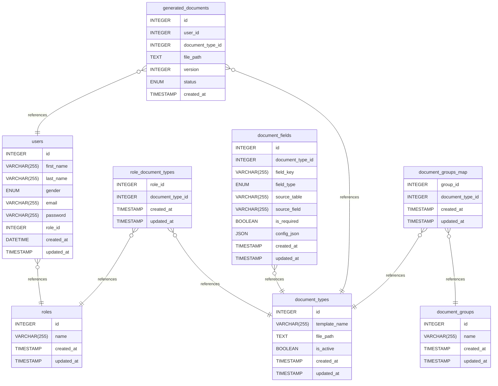

# CMC-DMS Database Documentation

---

## Table of Contents

1. [Introduction](#1-introduction)
2. [Database Type](#2-database-type)
3. [Core Design Overview](#3-core-design-overview)
4. [Table Structure](#4-table-structure)
   - 4.1 [document_types](#41-document_types)
   - 4.2 [document_groups](#42-document_groups)
   - 4.3 [document_fields](#43-document_fields)
   - 4.4 [document_groups_map](#44-document_groups_map)
   - 4.5 [generated_documents](#45-generated_documents)
   - 4.6 [users](#46-users)
   - 4.7 [role_document_types](#47-role_document_types)
   - 4.8 [roles](#48-roles)
5. [Relationships](#5-relationships)
6. [Database Diagram](#6-database-diagram)

---
## 1. Introduction

This database is designed for a Document Management System (DMS).  
It handles document templates, dynamic fields, role-based access control, and generated document tracking with versioning.

The system allows controlled access to documents based on user roles and supports structured document generation from reusable templates.

---

## 2. Database Type

- **DBMS:** MySQL  
- **Model:** Relational database  
- **Architecture:** RBAC (Role-Based Access Control) with document template system  

---

## 3. Core Design Overview

The system is built around the following components:

- **Document Types:** Define templates and metadata
- **Document Fields:** Define dynamic fields inside templates
- **Document Groups:** Organize document types
- **Roles:** Control access to document types
- **Generated Documents:** Store output history with versioning per user

---

## 4. Table Structure

---

### 4.1 document_types

Stores document templates used for generation.

| Column | Type | Description |
|--------|------|-------------|
| id | INTEGER | Primary key |
| template_name | VARCHAR(255) | Unique template name |
| file_path | TEXT | Path to template file |
| is_active | BOOLEAN | Whether template is active |
| created_at | TIMESTAMP | Creation time |
| updated_at | TIMESTAMP | Last update time |

**Constraints:**
- UNIQUE(template_name)

---

### 4.2 document_groups

Defines groups used to categorize document types.

| Column | Type | Description |
|--------|------|-------------|
| id | INTEGER | Primary key |
| name | VARCHAR(255) | Unique group name |
| created_at | TIMESTAMP | Creation time |
| updated_at | TIMESTAMP | Last update time |

**Constraints:**
- UNIQUE(name)

---

### 4.3 document_fields

Defines dynamic fields used in document templates.

| Column | Type | Description |
|--------|------|-------------|
| id | INTEGER | Primary key |
| document_type_id | INTEGER | Related document type |
| field_key | VARCHAR(255) | Template placeholder key |
| field_type | ENUM | Type of input field |
| source_table | VARCHAR(255) | Source table if AUTO |
| source_field | VARCHAR(255) | Source field if AUTO |
| is_required | BOOLEAN | Required field flag |
| config_json | JSON | Extra configuration |
| created_at | TIMESTAMP | Creation time |
| updated_at | TIMESTAMP | Last update time |

**Field Types:**
- AUTO
- INPUT
- SELECT
- DATE
- NUMBER

**Constraints:**
- UNIQUE(document_type_id, field_key)
- INDEX(document_type_id)

---

### 4.4 document_groups_map

Many-to-many relation between document groups and document types.

| Column | Type | Description |
|--------|------|-------------|
| group_id | INTEGER | Group reference |
| document_type_id | INTEGER | Document type reference |
| created_at | TIMESTAMP | Creation time |
| updated_at | TIMESTAMP | Last update time |

**Primary Key:**
- (group_id, document_type_id)

---

### 4.5 generated_documents

Stores history of generated documents per user.

| Column | Type | Description |
|--------|------|-------------|
| id | INTEGER | Primary key |
| user_id | INTEGER | Owner user |
| document_type_id | INTEGER | Related document type |
| file_path | TEXT | Generated file path |
| version | INTEGER | Version per user/document |
| status | ENUM | Generation status |
| created_at | TIMESTAMP | Creation time |

**Status:**
- PENDING
- FAILED
- SUCCESS

**Constraints:**
- UNIQUE(user_id, document_type_id, version)
- INDEX(user_id, document_type_id)

---

### 4.6 users

Stores system users.

| Column | Type | Description |
|--------|------|-------------|
| id | INTEGER | Primary key |
| first_name | VARCHAR(255) | First name |
| last_name | VARCHAR(255) | Last name |
| gender | ENUM(M,F) | Gender |
| email | VARCHAR(255) | Unique email |
| password | VARCHAR(255) | Hashed password |
| role_id | INTEGER | Reference to role |
| created_at | DATETIME | Creation time |
| updated_at | TIMESTAMP | Last update time |

---

### 4.7 role_document_types

Defines which document types are accessible by each role.

| Column | Type | Description |
|--------|------|-------------|
| role_id | INTEGER | Role reference |
| document_type_id | INTEGER | Document type reference |
| created_at | TIMESTAMP | Creation time |
| updated_at | TIMESTAMP | Last update time |

**Primary Key:**
- (role_id, document_type_id)

---

### 4.8 roles

Defines system roles.

| Column | Type | Description |
|--------|------|-------------|
| id | INTEGER | Primary key |
| name | VARCHAR(255) | Unique role name |
| created_at | TIMESTAMP | Creation time |
| updated_at | TIMESTAMP | Last update time |

---

## 5. Relationships

- users → roles (many-to-one)
- roles → document_types (many-to-many via role_document_types)
- document_types → document_fields (one-to-many)
- document_types → document_groups (many-to-many via document_groups_map)
- users → generated_documents (one-to-many)
- document_types → generated_documents (one-to-many)

---

## 6. Database Diagram

